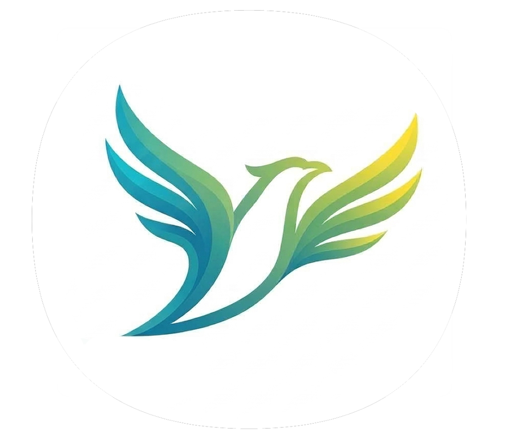

# ＲｅＢｏｕｎｄ
Rebound is an Adaptive Social Media Relapse Model 

It is close to impossible to simply quit a bad addiction ‘cold turkey’, our application gives a personalized and structured timeline for a realistic ease off of an addiction 

Overview
Standard app blockers rely on rigid daily limits that often trigger the Abstinence Violation Effect (AVE)—leading to total goal abandonment when a user overshoots their limit by even a few minutes.
This model treats excessive social media use as a dynamic emotional regulation issue. By combining daily subjective check-ins (craving, withdrawal, FOMO, stress) with objective behavioral telemetry (inter-login frequency and daily duration), the algorithm dynamically adjusts daily target recommendations to optimize long-term adherence and prevent relapse.

  <!-- Main Featured Logo/Graphic -->
  

  # Rebound

  ### *Take back your time from the infinite scroll.*

  <!-- Custom Styled Badges / Links -->
  

    
    
    
  

---

## About Rebound

**Rebound** is an anti-doomscrolling Chrome extension designed to help you break free from addictive social media feeds (like TikTok and Instagram). Featuring high-priority DOM intervention banners, Rebound keeps you mindful of your daily digital limits without getting in your way.

---

## Features

* **Instant Site Interception:** Automatically detects when you navigate to TikTok or Instagram.
* **Daily Goal Tracking:** Displays live remaining time indicators to keep your scrolling habits in check.
* **Aesthetic Minimalist UI:** Custom dark-mode warning overlays with your very own soaring pastel bird logo.
* **High-Priority Injection:** Bypasses complex site wrappers using max `z-index` DOM overlays.

---

## Quick Local Setup

1. **Download or Clone** this repository to your local machine.
2. Open Google Chrome and navigate to `chrome://extensions/`.
3. Toggle **Developer mode** on in the top-right corner.
4. Click **Load unpacked** and select your `Rebound-extension` folder.
5. Download Libraries in terminal: pip install pygetwindow websockets matplotlib numpy
6. Run the "start.py" file

---

## Planning Process and Project Research
See the mathematics and neuroscience behind our model here:
https://docs.google.com/document/d/1aGy8eP8ZeS42rUoAZx-p-r2IdaPxZM-8INkOuI_EfVg/edit?usp=sharing

---

  
Built for mindful scrolling

  by Shaugnessy Pump, Ricky Wu, Victor Sen, Kaito Nagawaka 

